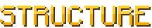

<div align="center">



C++20 · SFML · Dear ImGui · 42 School

</div>

## 

**Gomoku** (五目並べ) is a strategy board game traditionally played on a goban with black and white stones.
The goal of this 42 project: build an **AI able to beat human players**, in under half a second per move.

<table>
<tr>
<td width="50%" valign="top">

### Game modes
- **Player vs AI**: the AI has to win, without you letting it
- **Player vs Player**: on the same machine, with move suggestions
- Timer showing how long the AI takes to think

</td>
<td width="50%" valign="top">

### Under the hood
- **Minimax** with **Alpha-Beta** pruning
- Heuristic evaluation of alignments
- Target: **< 0.5 s** per move
- **SFML** + **Dear ImGui** interface

</td>
</tr>
</table>

## 

| Rule | Description |
|---|---|
| **Alignment** | Align **5 or more stones** on a **19×19** goban to win |
| **Capture** | Flank a **pair** of opponent stones to remove it. **10 captured stones = victory** |
| **Endgame capture** | A five-in-a-row only wins if the opponent cannot break it by capturing a pair |
| **No double-three** | A move creating two *free-threes* at once is forbidden |

<div align="center">

</div>

## 

```bash
git clone <repo-url> Gomoku && cd Gomoku
make        # build the binary
./Gomoku    # start the game
```

| Command | Effect |
|---|---|
| `make` / `make all` | Build the project |
| `make clean` | Remove object files |
| `make fclean` | Remove object files and binary |
| `make re` | Rebuild everything |

## 

```
Gomoku/
├── assets/          # README visuals
├── libs/            # SFML · Dear ImGui · ImGui-SFML
├── src/
│   ├── main.cpp
│   ├── ui/          # Menus & SFML / ImGui rendering
│   │   └── mainMenu
│   ├── app/         # Contract between the UI and the engine
│   │   ├── Dto.hpp     # Shared types: Pos, Cell, MoveResult, MoveSuggestion, GameView
│   │   └── GameService # Facade: new game, play a move, move suggestion
│   └── core/        # Game engine, no graphics dependency
│       ├── Board       # 19×19 goban
│       ├── Rules       # Captures, five-in-a-row, double-three
│       ├── Game        # Game state: turn, captures, winner, undo
│       └── ai/
│           ├── Search  # Time-limited Minimax + Alpha-Beta
│           └── Eval    # Evaluation heuristic
└── Makefile
```

The UI only talks to `GameService` and only handles the types from `Dto.hpp`, so the `core` can evolve without touching the rendering.
